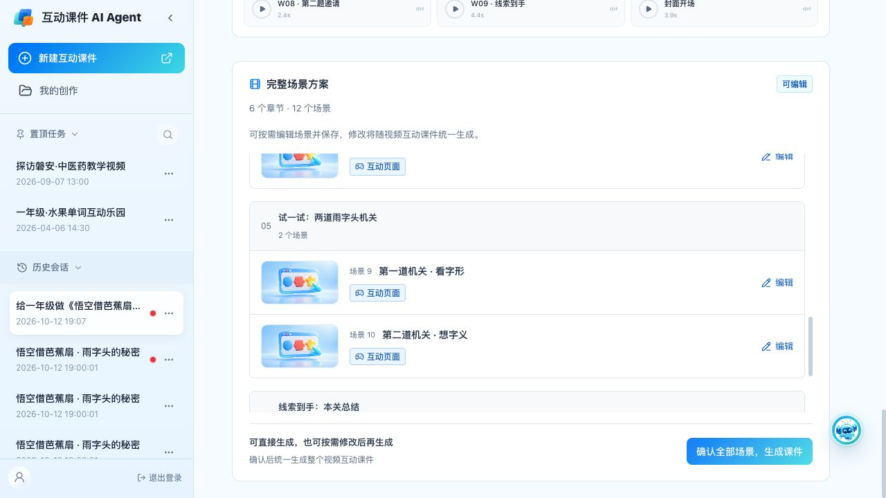
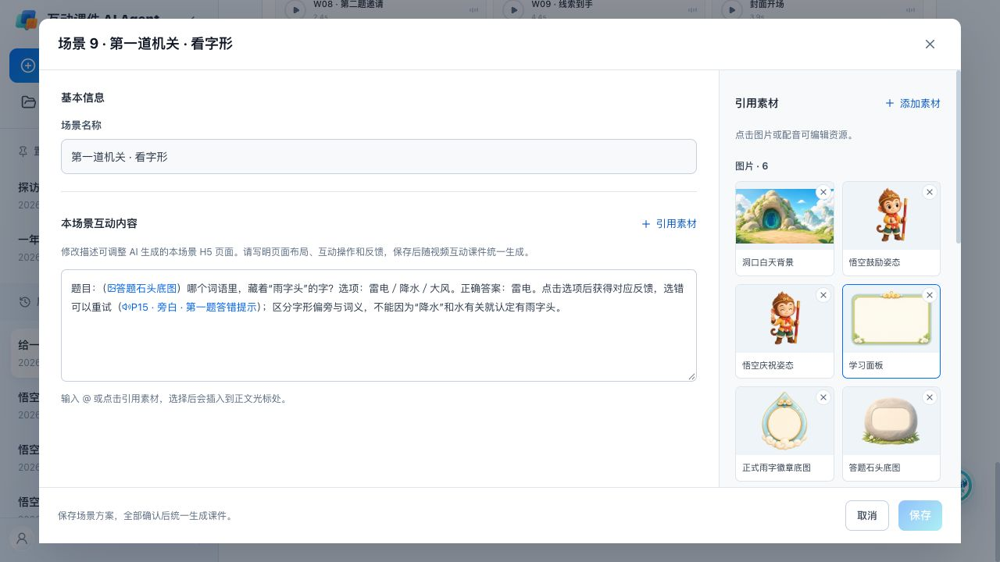
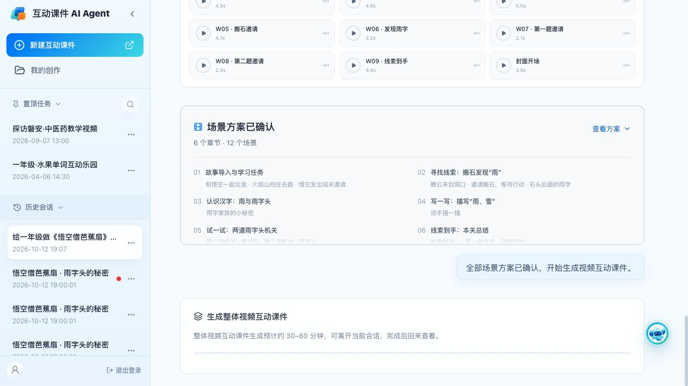

# 文案、场景排版与资源编辑

2026-10-12，本地分支 `codex/whole-html-review-20261012`；本轮修改前为 `127cdbc`。未推送、未部署，不修改正式 PRD。

| 修改说明 | 页面实测 |
| --- | --- |
| 场景列表改为两行：第一行场景编号与名称，第二行场景类型与已编辑保存标记。默认图片暂时沿用旧图。 |  |
| 图片引用显示图片图标，音频引用显示音频图标，保留蓝色文字。图标覆盖原 @ 字符的位置，底层引用文本不变，避免改动光标与复制逻辑。互动内容说明不再称“整课”。 |  |
| 生成标题使用“生成整体视频互动课件”，耗时提示使用“整体视频互动课件生成预计约 30–60 分钟，可离开当前会话，完成后回来查看。” |  |

其他调整：

- 教学内容菜单的“从云盘课件选页面”移到第一项。
- 确认区使用“可直接生成，也可按需修改后再生成”和“确认后统一生成整个视频互动课件”。
- 视频互动课件相关界面、错误提示、修改范围不再使用“整课／整节课”。
- 移除顶部“课件设置”入口及其开关弹窗，修改意见沿用输入框与草稿流程。
- 恢复最新版“编辑资源”入口，不再显示敬请期待。资源修改加入与场景、聊天修改共用的草稿；保存时保留当前版本，点击“全部生成”后更新完整视频互动课件。过期草稿或生成中的写入被拒绝。
- 旧版结果不可直接编辑；历史课件 HTML 不覆盖，线上历史课件不受影响。

验证：浏览器实际检查菜单顺序、确认文案、两行布局、引用图标、生成提示、设置入口移除、资源编辑打开及保存为草稿。`npm run build`、`git diff --check` 通过。`node scripts/check-resource-course-draft.mjs` 验证资源修改保留已有场景及聊天草稿、旧结果不变、重开可恢复、拒绝过期写入、统一生成后仅新增一个版本。

待完成：用户要求通过内部 image2 重做三张默认配图；当前会话仅开放 imagegen，未提供内部 image2 调用接口。按照用户要求未使用 AIGC 网站或 imagegen 替代，三张图未重绘。
