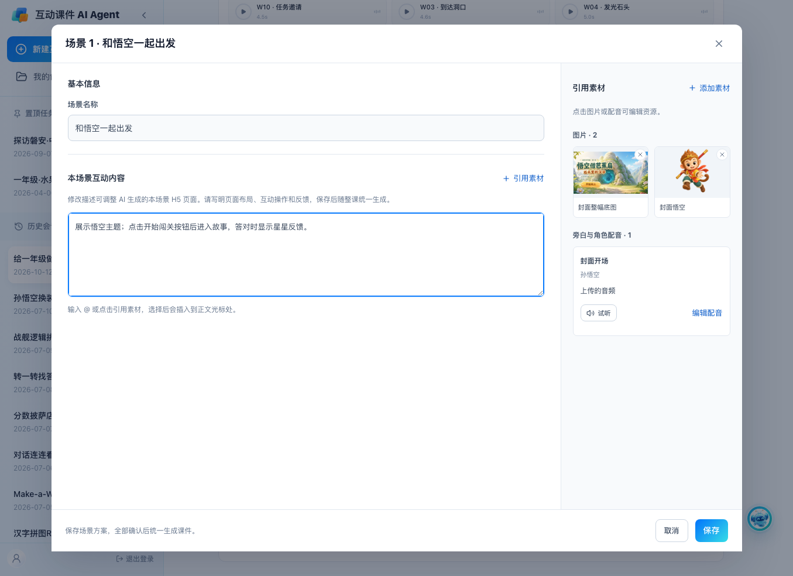
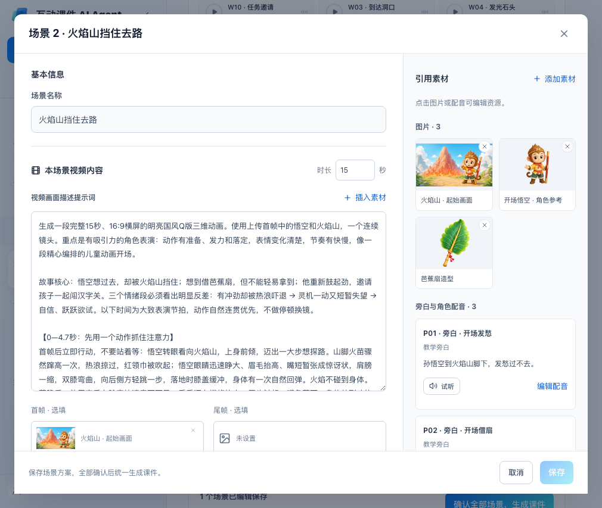
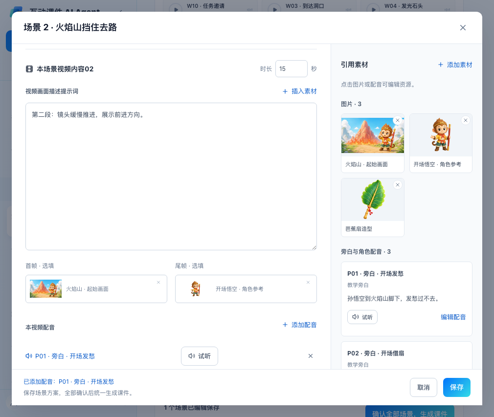
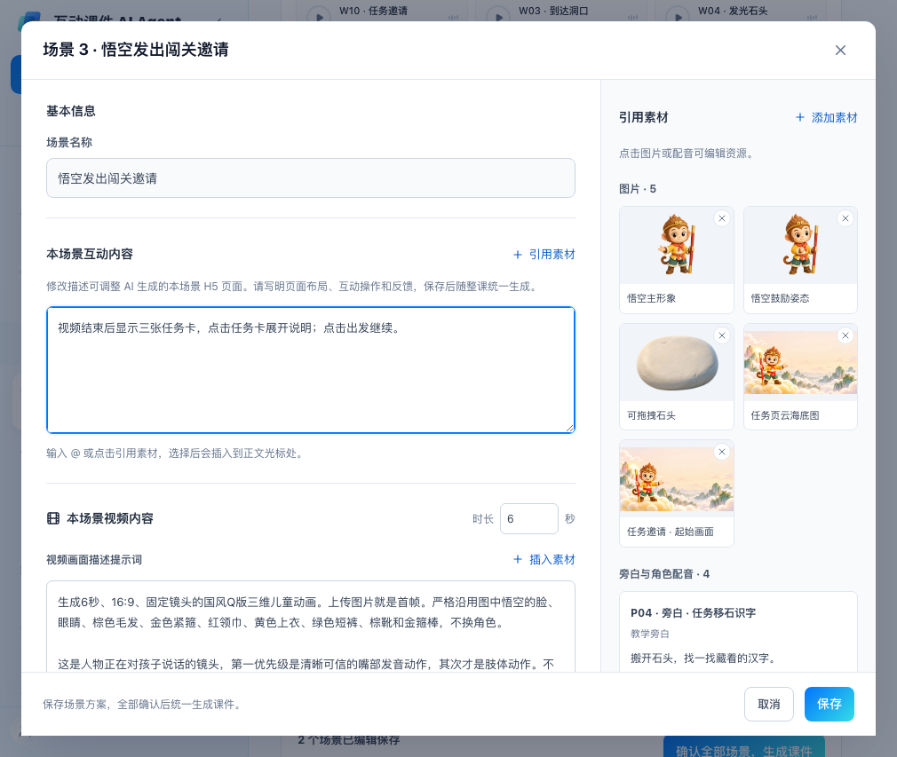
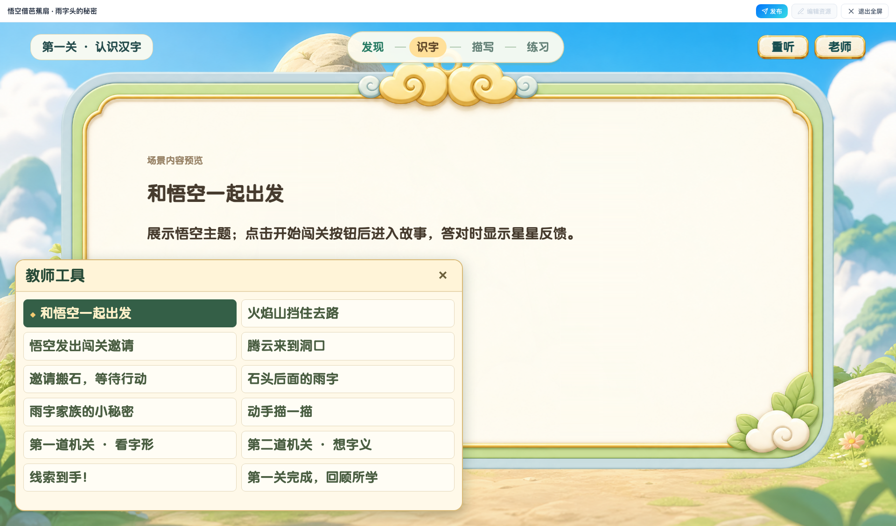

# 场景类型、内容编辑与教师工具：八条批注

2026-10-12，本地评审分支 `codex/whole-html-review-20261012`。本轮修改前提交：`0ae9915`。本地入口：[Demo](http://127.0.0.1:4186/)。未推送或部署，正式 PRD 未更新。

## 修改说明（左文右图）

| 修改说明 | 本地实测截图 |
| --- | --- |
| **1—2. 场景列表简化。** 移除每场的内容摘要。以互动、视频、视频＋互动三张默认图表示类型，同一类型复用同一张图；保留场景名称、类型、编辑入口和已编辑保存标记。默认图与具体课件封面无关。 |  |
| **3. 纯互动编辑。** 模块名称统一为“本场景互动内容”。说明文案明确：修改描述可调整 AI 生成的本场景 H5 页面，请描述页面布局、互动操作与反馈，保存后随整课统一生成。 |  |
| **4. 纯视频编辑。** 隐藏原“本场景内容”整个模块，也不校验隐藏的旧内容字段。直接编辑视频提示词、时长、首尾帧及配音，不增加从场景摘要再生成视频描述的步骤。 |  |
| **5. 每段视频独立配置。** 只有一段时显示“本场景视频内容”；有多段时显示“本场景视频内容01 / 02 …”。每段独立配置“视频画面描述提示词”、首帧、尾帧和配音。添加/移除配音只影响当前视频的配音配置，不自动改写提示词；仍可通过“插入素材”或 @ 主动引用素材。 |  |
| **6. 视频＋互动编辑。** 同时显示“本场景互动内容”和“本场景视频内容”模块，分别描述互动页面与视频。修改互动描述不覆盖已填写的视频提示词。 |  |
| **7. 教师工具入口随画布缩放。** 入口按钮使用 1920×1080 坐标中的 184×56 尺寸，与课件内容一起等比缩放，避免小预览中按钮占比过大。 |  |
| **8. 教师工具展开为四分之一面积。** 左下角面板固定使用 960×540 画布坐标，即宽高各为画布一半；与画布同时缩放。两列展示场景，保持悟空配色与字体，无整屏遮罩。顶部课件设置继续控制入口显示。 |  |

## 默认图与生成提示词

本轮使用内置 **image_gen**，生成后将三张原图复制到项目内：

- [互动页面默认图](../public/video-courseware/scene-types/interactive.png)
- [视频页面默认图](../public/video-courseware/scene-types/video.png)
- [视频＋互动页面默认图](../public/video-courseware/scene-types/mixed.png)
- [完整生成提示词](../public/video-courseware/scene-types/README.md)

三图为同一套柔和立体插画，用蓝色互动拼图、紫色视频播放符号、青绿色视频＋互动组合区分类型；不包含文字。

## 验证与历史课件边界

- 13 项浏览器检查全部通过，页面脚本错误为 0；`npm run build` 与 `git diff --check` 通过。
- 浏览器验证覆盖三种场景模块、列表配图、隐藏字段校验、多视频配置独立保存、配音增删不改写提示词、刷新恢复、统一整课生成、教师工具跳转与比例；[检查结果](reviews/20261012-scene-content-types/checks.json)。
- 验证视口：1355×984、1010×853、1132×853；在 1920×1080 实际课件画布中测得面板为 960×540。
- 仍为产品交互 Demo，使用现有悟空资源与预览机制，未新增通用大模型 H5/视频生成服务。
- 原课件运行文件和持久化历史 HTML 不覆盖；已有本地悟空版本继续使用各自场景快照呈现更新后的教师工具，线上历史课件保持原状。
