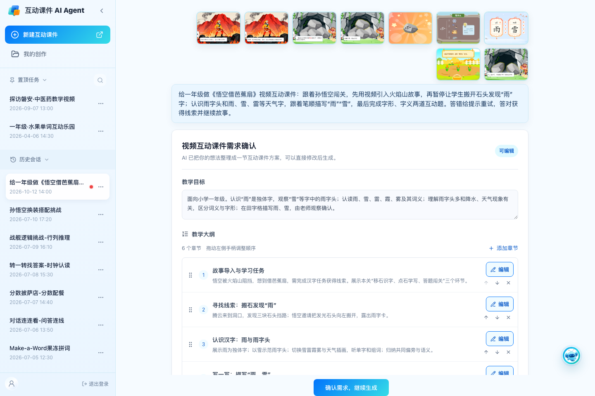
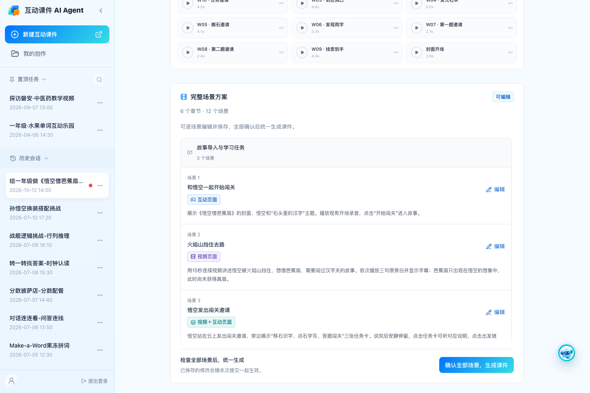
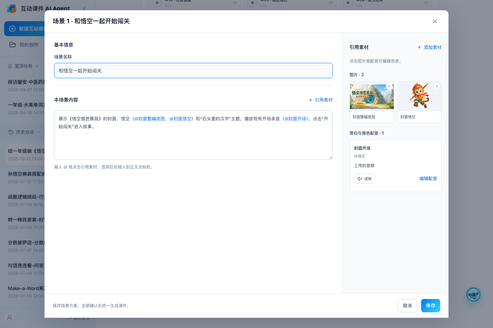
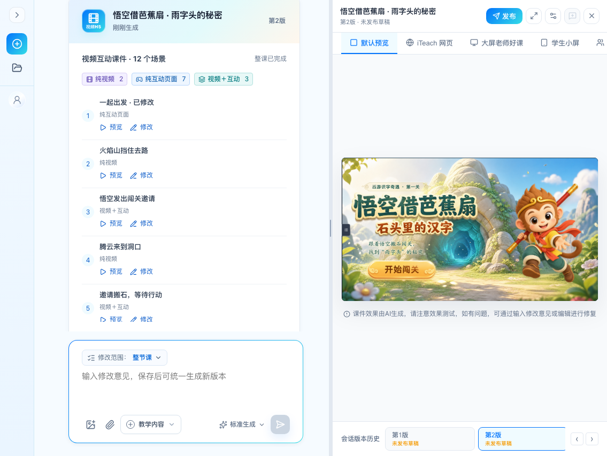
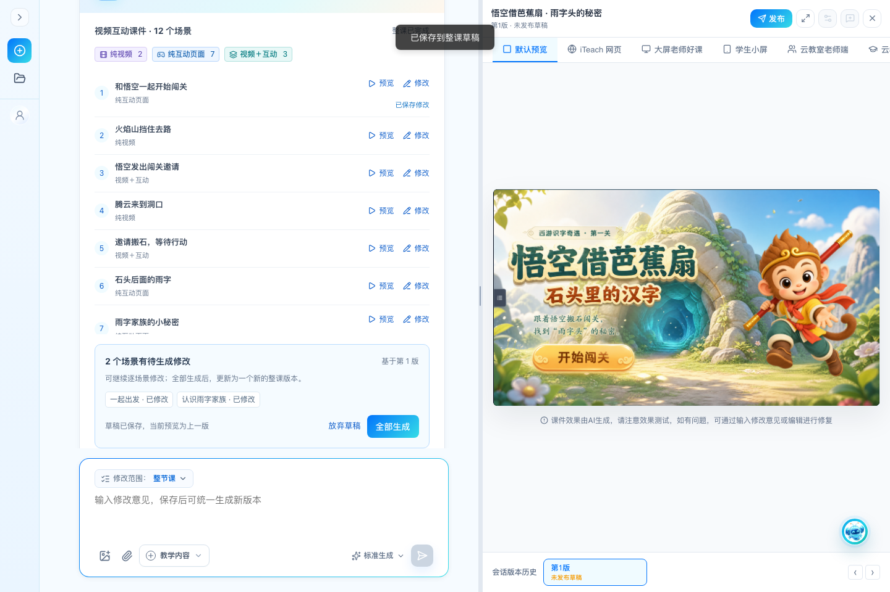
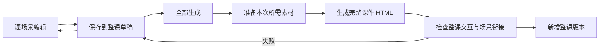

# 视频互动课件：整课统一生成（2026-10-12 本地评审）

## 评审入口与回退

- 本地入口：<http://127.0.0.1:4186/wukong-demo>（预填悟空案例，发送后开始演示）。
- 评审分支：`codex/whole-html-review-20261012`。
- 改动前保存点：`0370cb0`，分支 `codex/video-before-whole-html-20261012`。包含此前已完成的详细首页示例需求。
- 本次只在本地提交；未推送、未部署。既有未提交的历史评审资料和脚本保持原样。
- 正式 PRD 暂未改写，以本次评审结果确定取舍。

在本工程目录执行 `git switch codex/video-before-whole-html-20261012` 可回到改动前代码；执行 `git switch codex/whole-html-review-20261012` 可返回本次评审代码。切换后刷新本地页面。两分支复用本地项目存储；旧整课 HTML 和版本快照不会被本次编辑覆盖。

## 八条批注的处理

| 修改说明（左） | 本地实测截图（右） |
| --- | --- |
| **1. 首版前隐藏整个底部输入框。** 教学大纲确认按钮仍固定显示；首版完整课件生成成功后出现修改输入框。 |  |
| **2. 去掉场景列表缩略图。** 方案和结果列表使用场景序号、名称、类型及说明，不要求为每场获取封面。按批注选中的图片理解此项，课件内原有开场场景及编辑器中的引用图片保留。 |  |
| **3. 首版前逐场景只保存。** 编辑弹窗只提供“取消 / 保存”；所有场景核对完成后，点击“确认全部场景，生成课件”。保存不创建单场生成任务。 |  |
| **4. 场景不显示 Vn。** 整课保留第 1、2…版；单场只作为整课内的教学环节，预览定位到该版本对应场景。 |  |
| **5—7. 一键同款、编辑资源、标注修改暂不可用。** 视频课件入口置灰并提示“敬请期待”；全屏资源编辑同步禁用。普通 H5 的这些入口保持原有行为。 |  |
| **8. 首版后可连续修改多个场景，统一生成整课。** 保存进入同一份整课草稿；结果卡显示待生成场景和“全部生成”。聊天提交的场景/整课意见也先进入草稿。生成期间可查看上一版，完成后新增一个整课版本；失败保留草稿，可重试或放弃。 |  |

## 与桌面源码对应的判断

已阅读桌面 `代码/孙悟空/site/index.html` 和 `代码/Bobo的魔法午餐车_V4完整源码/` 中的 `app.js`、`index.html` 与源码阅读说明。

两例都是一个完整课件入口，共享导航、状态和媒体控制。悟空使用页面区域切换；Bobo 由 `render()` 根据 `S.scene`、`S.phase` 动态渲染场景。因此“每个场景是 section”可作为产品与实现约定，两个历史案例的具体 DOM 写法不完全相同。它们均不要求每场单独生成一份独立 HTML，再把多个 HTML 拼成课件。

本次评审流程：

素材可按图片、配音和视频任务准备或复用，课件生成和交付的单位始终是整课。历史版本使用已保存的 HTML；草稿不会改变当前已交付内容。

## 验证与边界

- 浏览器验证：首版前隐藏输入框、无列表缩略图、场景只保存、完整生成、无场景 Vn、三个入口禁用、连续保存、刷新恢复、集中提交、失败保留、放弃草稿、旧版本不变。
- 状态验证：禁止单场提交、共享素材修改隔离、场景/整课聊天草稿合并、防重复提交、过期草稿不能覆盖新版本。
- 视口：1440 × 960、1135 × 853；构建与 `git diff --check` 通过。
- 证据：[浏览器检查](reviews/20261012-whole-course/checks.json)、[草稿状态检查](reviews/20261012-whole-course/state-checks.json)、[聊天与入口检查](reviews/20261012-whole-course/chat-checks.json)。
- 当前仍为产品交互 Demo：使用预制悟空资源模拟素材与生成进度，未接入新的通用大模型 HTML/视频生成服务。本次修改的是生产 Agent 的交互和版本管理；桌面两个原课件源码、线上站点、历史已交付 HTML 均未覆盖。
